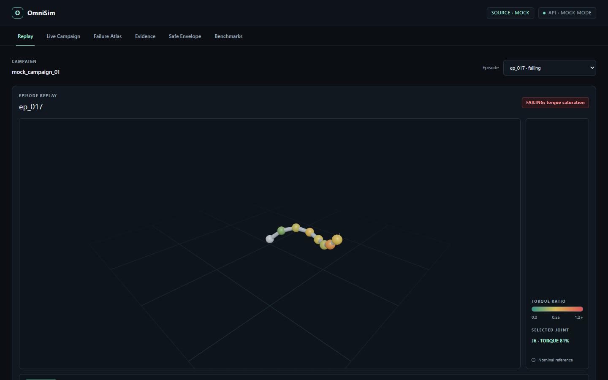
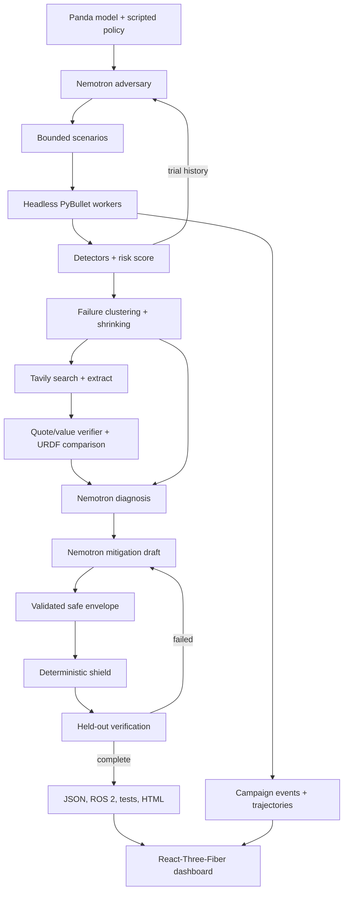

# OmniSim-Agent: Red-team your robot before the real world does

## The problem

A robot policy can succeed in simulation and still fail when payload, friction, latency, sensing, or actuator behavior differs from the model. A nominal simulation run does not show how close the policy is to a failure boundary. Teams need a repeatable way to find those boundaries and check whether a deterministic safety envelope changes the outcome.

## What it does

OmniSim-Agent runs a closed loop from scenario proposals to an exported operating envelope. The stages below follow `src/omnisim/core/` and `src/omnisim/`:

1. The Nemotron adversary proposes bounded scenarios from prior trial results.
2. Headless PyBullet workers run the policy and score risk and detector events.
3. Failure cases are clustered and shrunk; Tavily gathers manufacturer evidence for the diagnosis.
4. The diagnosis informs a candidate envelope, while ordinary Python code applies the deterministic shield.
5. Held-out scenarios check the shielded policy; the run writes evidence, replays, verification data, and export artifacts.

The React-Three-Fiber dashboard reads campaign data and displays trajectory replay, evidence, envelope, and benchmark views.



## Results

No reporting benchmark is present at `data/benchmark.json`, and no saved hero campaign or verification export is present under `data/demo_runs/hero/`. The strategy figures below come from the checked-in mock fixture; they are not live measurements.

| Metric | Recorded value | Source and status |
| --- | --- | --- |
| Nemotron simulations to first failure | 21.667 mean, lower bound | `[UNVERIFIED - REPLACE AFTER LIVE RUN]`; mock fixture `web/public/mock/benchmark.json` |
| Random simulations to first failure | 36.667 mean, lower bound | `[UNVERIFIED - REPLACE AFTER LIVE RUN]`; mock fixture `web/public/mock/benchmark.json` |
| CMA-ES simulations to first failure | 23.667 mean | `[UNVERIFIED - REPLACE AFTER LIVE RUN]`; mock fixture `web/public/mock/benchmark.json` |
| Held-out failure rate before → after shielding | Not measured in a live campaign | `docs/PROGRESS.md`, Phase 8 records an eight-scenario simulation test but no rates |
| Blocked rate | Not measured in a live campaign | `docs/PROGRESS.md`, Phase 8; no hero verification file is present |
| Completion rate | Not measured in a live campaign | `docs/PROGRESS.md`, Phase 8; no hero verification file is present |
| Cycle-time cost | Not measured in a live campaign | `docs/PROGRESS.md`, Phase 8; no hero verification file is present |
| Token usage | 2,407 tokens in one successful fast-role response; the log has no `run_id`, so this is not a campaign total | `data/llm_calls.jsonl` |

The Phase 4 seed-17 simulator smoke recorded nominal risk 0.98 with no events and maximum torque ratio 0.3410; the 3 kg payload plus speed-scale-2 case recorded risk 1.75, tracking and velocity events, and maximum torque ratio 0.7975; torque scale 0.5 recorded risk 0.99 with no events and maximum torque ratio 0.6821 (`docs/PROGRESS.md`, Phase 4). These are simulator smoke results, not hardware measurements. The Phase 8 eight-scenario ON/OFF test passed with PyBullet DIRECT, but `docs/PROGRESS.md` does not report its rates.

## Architecture



Campaign orchestration and persistence live in `src/omnisim/core/campaign.py`; API jobs and routes live in `src/omnisim/api/`; dashboard code lives in `web/src/`.

## How we use NVIDIA Nemotron on Nebius Token Factory

`src/omnisim/llm/nebius.py` sends JSON-schema tasks through the OpenAI-compatible Nebius Token Factory endpoint. `src/omnisim/llm/models.py` lists available models and selects only NVIDIA Nemotron IDs. The configured defaults are `nvidia/Nemotron-3_5-Lightning` for `fast` and `nvidia/nemotron-3-super-120b-a12b` for `deep` (`.env.example`). The fast role proposes scenarios repeatedly from trial history. The deep role extracts specifications from supplied evidence, diagnoses failures, and drafts mitigation constraints (`src/omnisim/agents/adversary.py`, `src/omnisim/knowledge/tavily_agent.py`, `src/omnisim/agents/diagnostician.py`, `src/omnisim/agents/mitigator.py`).

`src/omnisim/llm/budget.py` tracks token use and checks the daily cap before each completion attempt. The response parser strips `<think>` blocks, falls back to `reasoning_content` when `content` is empty, validates parsed JSON against Pydantic models, and asks for a repair when parsing or validation fails (`src/omnisim/llm/json_utils.py`, `src/omnisim/llm/nebius.py`). When `finish_reason` is `length`, the next output attempt doubles `max_tokens`, capped at 8192, as recorded in `docs/DECISIONS.md`. Calls log role, model, timing, token counts, and outcome without prompts or credentials (`data/llm_calls.jsonl`).

## How we use Tavily

`src/omnisim/knowledge/tavily_agent.py` uses advanced-depth searches restricted to `franka.de`, `frankaemika.github.io`, and `docs.franka.de`, then extracts full page text. It searches for joint limits and error taxonomy separately; known-issue corroboration may also search GitHub, but GitHub does not supply specification evidence (`docs/DECISIONS.md`).

Search parameters and extracted pages are stored on disk under `data/tavily_cache/`, with a SHA-256 cache key and atomic file replacement (`src/omnisim/knowledge/cache.py`). `src/omnisim/knowledge/verifier.py` normalizes whitespace and Unicode punctuation, requires a quote to occur in the extracted page, and checks that the quoted text contains the claimed number or value. This verifies the quote and value are present; it does not establish that the quote supports the claim. Only verified evidence is compared with URDF limits or used in the safe envelope (`src/omnisim/knowledge/compare.py`, `src/omnisim/agents/mitigator.py`).

## Quickstart

```sh
git clone https://github.com/Cosmos-Coder-Ray/OmniSim-Agent.git
cd OmniSim-Agent
cp .env.example .env
# Set NEBIUS_API_KEY and, when using knowledge search, TAVILY_API_KEY in .env.
uv sync --locked
make check
make sim-smoke
make api
make web
docker compose up -d
```

The simulator smoke command runs headless. The API and web development servers are separate processes; run their commands in separate terminals (`Makefile`). For container deployment and production settings, see `docs/DEPLOY.md`.

## Live demo and recorded demo

Public demo: `[PUBLIC_DEMO_URL]`  
YouTube video: `[YOUTUBE_VIDEO_URL]`

With `OMNISIM_DEMO_MODE=false`, campaign requests use live execution and require configured provider credentials. With `OMNISIM_DEMO_MODE=true`, the API serves a saved campaign from `data/demo_runs/` and labels it as recorded. The expected showcase name is `hero`; the current checkout does not include `data/demo_runs/hero/`, so the recorded demo is not ready until a validated run is saved there (`src/omnisim/api/main.py`, `scripts/save_demo_run.py`).

## Repository layout

```text
OmniSim-Agent/
├── data/                    # URDF limits, provider logs/caches, saved demo runs
├── docs/                    # specification, decisions, progress, deployment, images
├── scripts/                 # campaign, benchmark, smoke, export, and demo commands
├── src/omnisim/
│   ├── agents/              # adversary, diagnosis, mitigation, baselines
│   ├── api/                 # FastAPI routes, jobs, storage, streaming
│   ├── core/                # campaign, clustering, shrinking, shield, verification
│   ├── export/              # envelope, ROS 2, regression, HTML report
│   ├── knowledge/           # Tavily, cache, evidence verification, URDF comparison
│   ├── llm/                 # Nebius client, models, budget, prompts
│   └── sim/                 # Panda environment, policy, perturbations, detectors, runner
├── tests/                   # unit, integration, end-to-end, recorded LLM fixtures
├── web/                     # React, TypeScript, R3F dashboard and mock data
├── Dockerfile
├── Makefile
├── pyproject.toml
└── uv.lock
```

## Limitations and caveats

The simulation runs PyBullet in DIRECT mode and uses a rigid-body model with simplified payload and contact assumptions (`src/omnisim/sim/`, `docs/DECISIONS.md`). The inverse-dynamics torque table omits closed-loop transients and unobservable link-mass scaling (`docs/DECISIONS.md`, Phase 8). A simulation envelope is not hardware certification. Hardware limits shown in an envelope require verified manufacturer evidence, and held-out results apply only to the specified simulation scenarios.

## Roadmap

- Fit a Reality Anchor from recorded CSV data.
- Compare results across PyBullet and MuJoCo.
- Evaluate pretrained SB3 policies.
- Add a Robot-CI GitHub Action.

These items are proposed work, not implemented features.

## License

Apache-2.0 (`LICENSE`).
